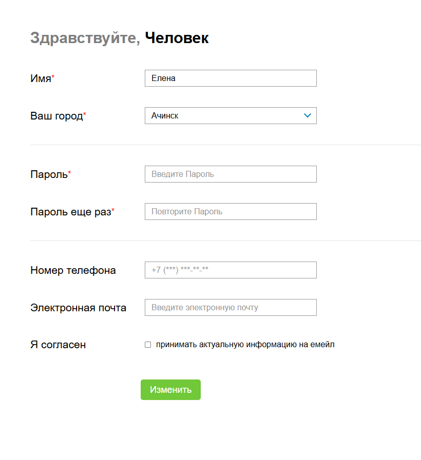

# Registration Form

Форма регистрации на Next.js с валидацией полей, выбором города и отправкой данных на собственный API-роут.

🔗 **Демо:** [ссылка](https://sweetp35-registration-form.netlify.app/)



## Стек

- **Next.js** (App Router) + **React** + **TypeScript**
- **API Routes** Next.js — список городов и приём данных формы
- **SCSS Modules** — изолированные стили компонентов
- **ESLint**

## Возможности

- Валидация всех полей с выводом ошибок под каждым полем:
  - имя: обязательно, минимум 2 символа, только кириллица
  - пароль: минимум 6 символов, только латинские буквы, проверка совпадения с повтором
  - email: проверка формата; обязателен, если включена подписка
- Выпадающий список городов: данные приходят с API-роута `/api/cities`, отфильтрованы по населению (больше 50 000) и отсортированы по алфавиту
- Отправка формы на `/api/submit`
- Сохранение имени в localStorage и вывод даты последней отправки
- Переиспользуемые компоненты: поле формы, селект, кнопка, чекбокс

## Запуск

```bash
npm install
npm run dev
```

Откройте [http://localhost:3000](http://localhost:3000).
